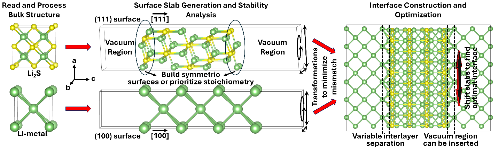

# Summary

Modelling solid–solid interfaces is a critical challenge in computational materials science, particularly for the electrode–electrolyte interfaces of all-solid-state batteries. Existing tools for interface construction often require extensive manual input, or lack automation for key steps such as structural optimisation and energy evaluation. *INTERFACER* is a Python package that automates the construction, optimisation and analysis of solid–solid interfaces. Starting from two bulk crystal structures, it generates surface slabs, ranks their terminations, matches their surface lattices, stacks them into vacuum or periodic (sandwich) interface models, and reports the work of adhesion and the interface energy. Any structure format supported by the Atomic Simulation Environment (ASE) [@ase] can be read.

INTERFACER drives density functional theory (DFT) calculations with VASP [@vasp1; @vasp2; @vasp3], CASTEP [@castep], GPAW [@gpaw] and the linear-scaling code ONETEP [@onetep]. It also supports machine-learning interatomic potentials such as MACE [@mace; @macemp], CHGNet, ORB, SevenNet and fairchem/UMA, any other ASE calculator, and simple potentials (Lennard-Jones, Morse, EMT) for building structures quickly. While developed for battery materials, INTERFACER applies to any solid–solid interface. It also builds grain boundaries and three-layer (slab | interlayer | slab) stacks.

# Statement of need

Computational studies of solid–solid interfaces need careful consideration of the surface termination, the lattice matching and the stability of the interface. Building interface models by hand is time-consuming and error-prone, and it hinders high-throughput studies. Existing tools such as pymatgen's interface builder [@pymatgen] provide interface generation, but no built-in optimisation workflows. INTERFACER addresses this gap with an automated, restartable pipeline that:

- generates the interface models;
- tests their convergence with respect to the slab thickness, the vacuum, the interlayer separation and the lateral registry;
- optimises their geometries;
- evaluates the key interfacial properties: surface (formation) energies, work of adhesion and interface energy.

The same workflow runs with a machine-learning potential for fast pre-screening and with DFT for the final models. This lets users screen many terminations and registries cheaply before spending DFT time on the most relevant ones.

# Functionality

INTERFACER is installed with `pip` and provides the `interfacer` command, which can read its options from TOML, YAML or JSON input files, and a Python API (`interfacer.workflow`). It automates the following steps (\autoref{fig:workflow}):

1. **Bulk structures.** Bulk structures from structure searches such as AIRSS [@airss1; @airss2], databases such as the ICSD [@icsd], or the user (`-i1`, `-i2`) are optimised, including their lattice parameters.
2. **Surface slabs.** Slabs are cut for any Miller indices (`-m1`, `-m2`) and number of layers (`-cr1`, `-cr2`). They are stoichiometric by default; alternatively, all symmetric terminations are generated (`-sym_slabs1/2`), either with pymatgen or with INTERFACER's own generator, which uses spglib [@spglib] to identify equivalent top and bottom surfaces. The slabs are relaxed in separate folders, so INTERFACER can also be used to generate and analyse surfaces only.
3. **Surface stability.** Surface energies are computed for stoichiometric slabs, and surface formation energies for non-stoichiometric ones. The chemical potentials are given directly or obtained from decomposition products, and the formation energies can be mapped as a function of the chemical potential to find the stable termination in each chemical environment. Optional tests screen several surfaces (`-tsur`) and converge the slab thickness (`-tlay`).
4. **Interface construction.** The surface lattices of the two slabs are matched with integer supercell transformations [@strang; @jelver] that minimise the misfit and the supercell area, optionally followed by a 2D Minkowski reduction. The slabs are then stacked with a given separation and vacuum, and checked for clashing atoms.
5. **Interface optimisation.** The lateral registry (`-thor`) and the interlayer separation (`-tsep`) are scanned with rigid slabs, or the rigid-slab placement is optimised with SciPy [@scipy] (`-topt`). The interface is then relaxed, and the lattice misfit, the work of adhesion and the interface energy (Dupré relation) are reported. Surfaces can be passivated with pseudo-hydrogens (`-pass`, VASP), and layers can be fixed.
6. **Grain boundaries and multilayers.** Symmetric tilt and coincidence-site-lattice twist boundaries [@sutton] of one material are built with their Σ value and misorientation angle, and their energies are computed (`--gb`). A third material gives three-layer interfaces (`-i3`).

All results are written to a JSON file and CSV tables, and finished calculations are reused when a run is restarted. A dry-run mode writes all structures and DFT inputs without running any calculation. The package comes with documentation, a test suite run by continuous integration, and tutorials with analysis notebooks, from a seconds-long EMT example to MACE and VASP studies of battery interfaces.

# Comparison with existing tools

pymatgen's interface builder [@pymatgen] focuses on generating the initial interface stackings and does not provide end-to-end optimisation workflows. INTERFACER automates the evaluation of surface stability, the construction of the interface structure, the energy minimisation and several levels of convergence testing. It also drives VASP, CASTEP, GPAW, ONETEP and machine-learning potentials directly.

ARTEMIS [@artemis] and RAFFLE [@raffle] target the exploration of interface structures and the screening of heterostructure combinations. RAFFLE predicts interface structures with active learning. INTERFACER emphasises the atomic-level construction of interface models and the detailed control of slab construction, lattice matching and convergence workflows, with full DFT input and output handling. It is therefore complementary to these tools: candidate systems identified with ARTEMIS or RAFFLE can be refined into simulation-ready interface models with INTERFACER. For grain boundaries, dedicated generators such as aimsgb [@aimsgb] offer a wider range of boundary types; INTERFACER integrates the most common symmetric tilt and twist boundaries into the same energy workflow.

Finally, INTERFACER can generate optimised geometries without any DFT code, for example with a machine-learning potential. These can be refined further in other DFT codes, which makes INTERFACER a flexible tool for interface modelling across platforms.

# Availability and use

INTERFACER is released under the GNU General Public License v3.0 or later at <https://github.com/bkarasulu/INTERFACER-code>. It has been used in our recent study of lithium thiophosphate solid electrolytes and their interfaces with lithium metal [@sen2025], and in other ongoing work by us and other groups.

# Acknowledgements

<!-- Funding, computing resources (e.g. HPC facilities) and contributors to be added by the authors. -->

# References
